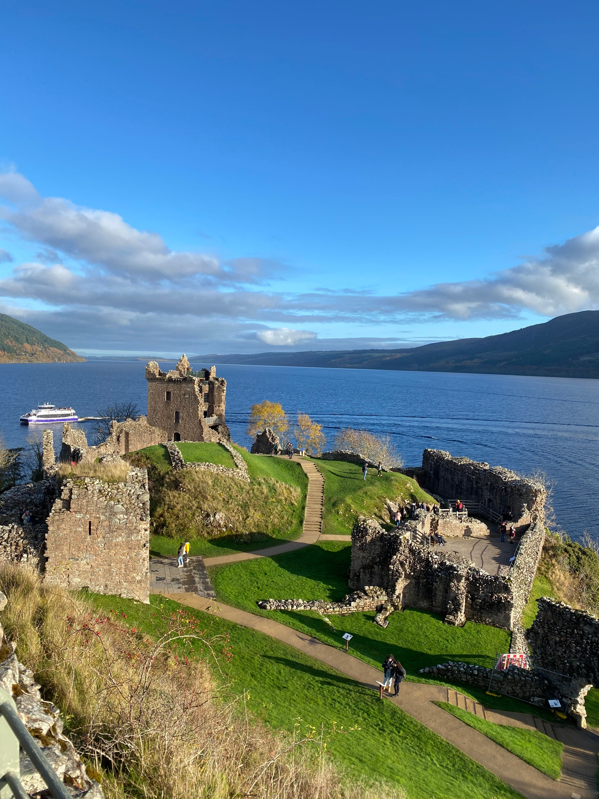

# Meet the Author Event
On this, my very first Markdown page, I am learning how to use GitHub. I will create a plan to organize a meet-the-author event featuring a book about Scotland.
## What I need to learn
I would like to learn how to use _GitHub_ to create, manage, and publish a web page using Markdown - in this case a web-page for the *Meet the Author Event* . I am excited to develop my technical skills, and challenge myself by learning something new. As first step, I am learning **text styling**, then I will follow with **lists**, continue with placing a **link* into the text and uploading an **image** to the webpage. 
## What to do before the event
1. Contact the author and agree on the date and the program.
2. Book a room with an additional 15-minute buffer before and after the event.
3. Create a digital poster and promote the event online, send email to the members.
4. Contact the partner organizations and share the event details with them so they can promote it as well.
5. Monitor the effectiveness of the event promotion - send a reminder email to everyone on the mailing list.
6. Prepare all necessary documents for event administration and payment processing.
7. A few days before the event, contact the author to review and confirm the event program. Wish him a good journey :-)
## What to do on the day of the event
- Get the keys and open the room.
- Open the windows to let in some fresh air.
- Welcome the guest, offer him a seat and a glass of water.
- Welcome the participants and ask him to fill in the list of participants.
- Open the event and hand over to the author.
- Do some photos.
- Thank the author and the participants for attending the event.
- Restore the room to its original setup.
- Return the keys.
## Use these images to promote the event
  
